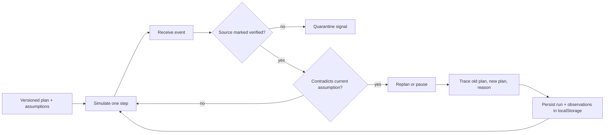

# Signal Room

A standalone, synthetic entry for DOO's [Adaptive Agent](https://build.doo.ooo/challenges/adaptive-agent) mission. This agent holds a multi-step plan, advances it one step at a time, consumes **event-driven observations**, and revises only when a verified signal contradicts an explicit plan assumption. Every revision says what changed, what the previous plan assumed, and why the replacement is safer. The run state and full trace persist in browser localStorage.

## Run

Open the [live demo](https://samerzaher80.github.io/signal-room-demo/) or serve a clean clone:

```bash
python -m http.server 8080
```

Visit `http://localhost:8080`. No API keys, accounts, dependencies, backend, or production connectors are required. Run `npm test` with Node 20+.

## Two changed-world scenarios

1. **Medical kit shipment:** The original route assumes the primary supplier has stock. After one simulated step, inject the verified stockout event. The agent revises to an alternate supplier route with human quote approval; the static baseline would continue reserving unavailable stock. Inject a second verified alternate stockout to see the agent pause and escalate instead of shipping without a supplier.
2. **Canary release:** The original plan assumes error rate is normal. A verified telemetry spike arrives before promotion. The agent changes to pause and review rollback; the static baseline would continue promoting a degraded release. The rollback step requires human review. No real deployment occurs.

Use **Simulate next step** to advance the state machine. **Inject verified change** processes an event immediately; no timer or repeated prompting drives adaptation. Reload to see the checkpoint retained. **Reset this run** clears only the selected synthetic run from localStorage.

## Architecture snapshot



`engine.js` is a pure state machine with scenario policy and explicit guards. `app.js` renders the plan, comparison baseline, event trace, and local checkpoint. All “executed” steps are labeled **simulated**. Consequential shipment, promotion, and rollback steps stop for named human review. A revision budget of two contains repeated plan churn; duplicate events are ignored.

## Failure test: bad adaptation from a false signal

Select either mission and click **Inject false rumor**. An unverified chat rumor reports the same disruptive fact as the verified event. A naive adaptive agent would switch plans based on the rumor and potentially harm the mission. Signal Room quarantines the event, keeps the world state and plan unchanged, and records why. The demo's `verified` flag is synthetic input, **not independently authenticated evidence**. In production, source authenticity, event ordering, and reliability would need a proper ingestion and trust layer. The test is about how the planning loop responds to declared source status, not proof of real telemetry integrity.

The state machine also contains a second failure boundary: when the alternate supplier disappears, no safe replacement exists, so the run pauses for review. Tests cover both changed-world scenarios, false signal containment, duplicate events, safe hold, human review, and serializing/restoring a revised run.

## Two-year thesis (under 300 words)

Adaptive agents will be judged less by how often they rewrite a plan than by whether each revision is tied to a trustworthy change in the world. A plan should carry explicit assumptions, evidence versions, a revision budget, and clear authority for irreversible steps. When new observations contradict those assumptions, the agent should preserve the old plan and explain the causal difference before choosing a replacement. Over the next two years, the core challenge will be the observation layer: verified provenance, event ordering, uncertainty, and deciding whether a signal is strong enough to justify disruption. Static baselines should remain visible, because a revision is only useful if it avoids a real failure rather than creating churn. Production systems will need durable checkpoints, replayable event logs, human approval for consequential actions, and outcome measurements that show whether adaptation improved the mission. The best adaptive agent will know when to stop adapting and ask a person.

## Scope and provenance

Built as a fresh public challenge demo by Sameer S. Najm / Sam AI Lab with Codex assistance. Scenarios, suppliers, telemetry, approvals, and event verification labels are synthetic. There are no private repositories, client records, clinical actions, real shipments, or deployment connectors in this build.

Inject the verified change (version 2), then deliver older evidence (version 1). The trace records the stale event without replacing the accepted fact. Versions represent synthetic evidence order per fact.